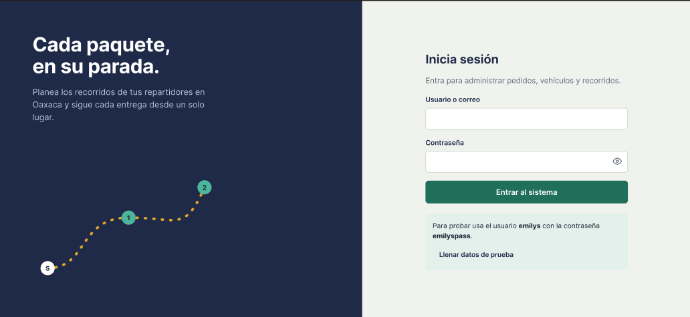
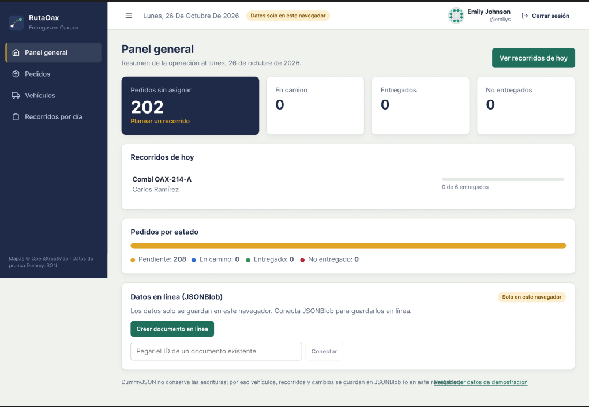
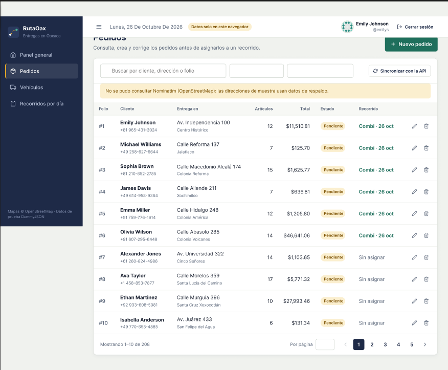
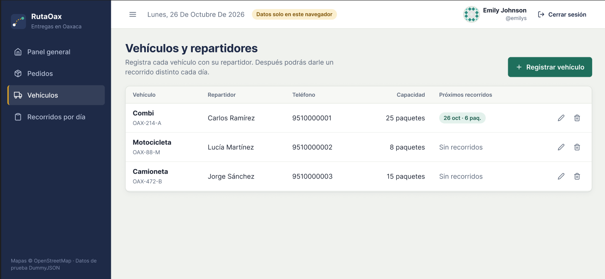
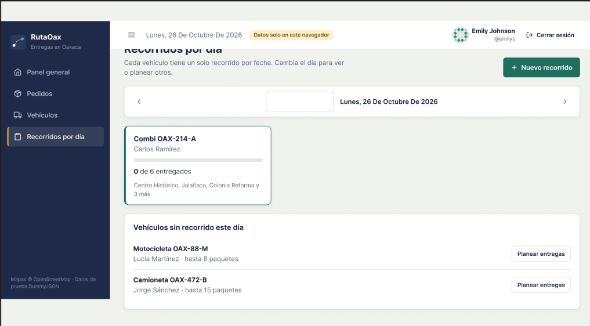
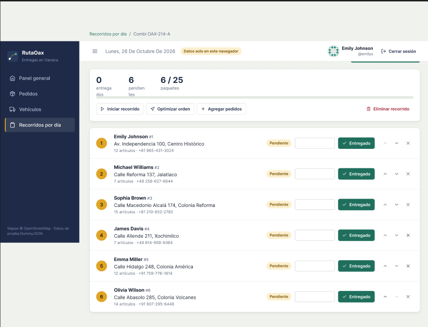

# RutaOax · Logística de entregas en Oaxaca

**Integrantes:** Osvaldo [Jose Jose] · Erick Omar [Santiago Ramirez]
**API de la tabla:** DummyJSON (carritos y usuarios como pedidos)
**Despliegue:** http://179.197.84.34/t3_act8_eq8/

Mini sistema en **React + Vite** para registrar pedidos, asignarlos a vehículos con su repartidor,
planear recorridos por día y ver la ruta de entrega en un mapa de Oaxaca.

## Cómo ejecutarlo

```bash
npm install
npm run dev        # abre http://localhost:5173
npm run build      # genera la carpeta dist/
```

Requiere Node.js 18 o superior y conexión a internet (APIs y mapa).

Opcional: copia `.env.example` a `.env` y escribe `VITE_JSONBLOB_ID` para que todo el equipo comparta los mismos datos; también se puede conectar desde el Panel general.

**Usuario de prueba:** `emilys` / `emilyspass` (cualquier usuario de https://dummyjson.com/users sirve).

## APIs que usa (todas gratuitas y sin API key)

DummyJSON (login, pedidos, estados) · Nominatim/OpenStreetMap (direcciones) · OSRM (rutas y orden de paradas) ·
JSONBlob (guardado en línea de vehículos y recorridos) · geolocalización del navegador.
Detalle en [docs/INTEGRACION_APIS.md](docs/INTEGRACION_APIS.md).

## Qué incluye

| Fase de la actividad | Dónde está |
|---|---|
| Fase 1 · Login con DummyJSON y validaciones | `src/pages/LoginPage.jsx`, `src/services/authService.js` |
| Fase 2 · Sidebar, navbar con foto/nombre/cerrar sesión, vista protegida | `src/components/layout/`, `src/components/auth/ProtectedRoute.jsx` |
| Fase 3 · Tabla con filtros, paginación en URL y CRUD | `src/pages/PedidosPage.jsx`, `src/services/pedidosService.js` |
| Extra del proyecto · Vehículos, recorridos por día y mapa | `src/pages/Vehiculos*`, `Recorrido*`, `src/components/recorridos/RutaMapa.jsx` |

## Documentación

| Documento | Contenido |
|---|---|
| [docs/DOCUMENTACION.md](docs/DOCUMENTACION.md) | Diseño del sistema y cómo cambiar cada parte |
| [docs/INTEGRACION_APIS.md](docs/INTEGRACION_APIS.md) | Cómo se integró cada API y dónde se reemplazó con JavaScript |
| [docs/CUMPLIMIENTO_RUBRICA.md](docs/CUMPLIMIENTO_RUBRICA.md) | Justificación de cada criterio de evaluación |
| [docs/GUIA_COMMITS.md](docs/GUIA_COMMITS.md) | Tabla de commits para subir el proyecto a GitHub |
| [bruno/README.md](bruno/README.md) | Colección de Bruno para probar las peticiones |

## Estructura

```
src/
  config/        constantes, estados, depósito y datos de respaldo
  services/      llamadas a APIs (auth, pedidos, direcciones, rutas, datos en línea)
  context/       estado global: sesión, avisos, pedidos/vehículos/recorridos
  utils/         distancias, fechas, localStorage
  components/    ui/ · layout/ · pedidos/ · vehiculos/ · recorridos/
  pages/         una página por pantalla
  styles/        theme.css (colores) y app.css (componentes)
```

## Diseño en Figma (Actividad 8)

Mockups que sirvieron de base para la interfaz del sistema.

### Login


### Panel general


### Logística (pedidos)


### Vehículos


### Recorridos


### Agenda de recorridos por día
